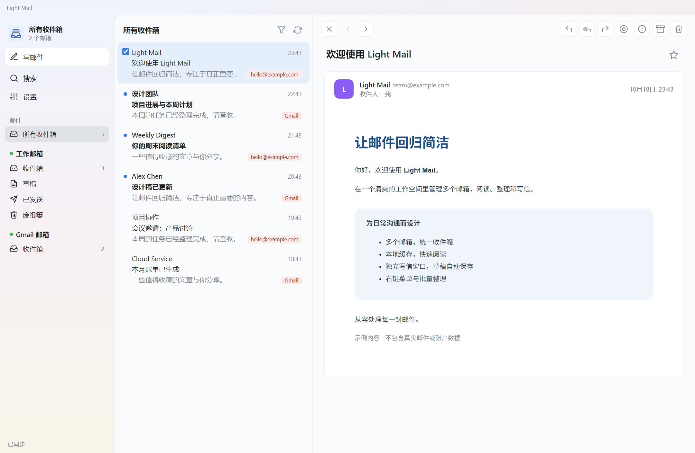

<p align="center"></p>
<h1 align="center">Light Mail</h1>
<p align="center">无广告的 Windows 邮件客户端，支持多邮箱、即时通知、本地缓存与自动保存草稿。</p>
<p align="center"><a href="https://github.com/yuzhounh/light-mail/releases/latest">下载 Windows 版本</a></p>



*截图使用示例邮件与账户，不包含真实邮件数据。*

## 下载与运行

当前源码及Windows日常版为 **0.3.0**；Android保持 **0.2.5/code22**，唯一日常APK为`dist/LightMail-0.2.5-code22.apk`，详见[Android说明](docs/android.md)。Windows已更新完整程序至`runtime/LightMail/LightMail.exe`：点击“全部邮箱”或账户标题查看对应范围的全部邮件，五类常用文件夹跨账户汇总，常驻搜索跟随当前范围，Ctrl+F聚焦、Esc清除；Gmail草稿、已发送、垃圾邮件和废纸篓已同步可见。两处“全部邮箱”图标统一紫色，标题与账户标题同为14px/600，无副文案；所有邮箱标题行上下留白对称并垂直居中。全局设置移至顶部右侧，移除下方设置按钮，全局及账户设置共用悬停或键盘聚焦显示的齿轮，固定32×32点击区，顶部22×22、下方17×17标准Feather圆形齿轮（无拉伸），点击设置不改变邮件范围。保留此前附件、表格换行及去选中竖线等修改。上一轮真实日用进程已确认0.3.0及原数据目录、4个可解密账户、草稿、自启动和使用偏好保持；窗口坐标及尺寸有正常重启取整差异。临时诊断已关闭。旧安装器、公开Release和Android包不包含本轮Windows功能，未重新发布。本次标准齿轮已完整更新到日用目录，按用户要求未启动客户端或进行界面验收。详情见[启动与更新记录](docs/startup-and-cache.md)。

在 [Releases](https://github.com/yuzhounh/light-mail/releases/latest) 下载：

- `LightMail-Setup-0.1.5-x64.exe`：安装版，可选择安装目录、创建快捷方式；安装完成后由用户自行启动，无需安装 Node.js。
- `LightMail-0.1.5-SHA256SUMS.txt`：安装包的 SHA-256 校验值。

适用于 Windows 10/11 x64。当前发布包未作代码签名。

## 功能

- 多账号、全部邮箱及账户内全部邮件；收件箱、草稿、已发送、垃圾邮件、废纸篓跨邮箱汇总，支持Gmail、QQ、163/126、腾讯企业邮箱及自定义IMAP/SMTP。
- 三栏界面，支持分栏调宽、邮箱别名与排序、浅色/深色主题。
- IMAP IDLE 新邮件通知、托盘常驻、开机自启动。
- 新邮件到达后自动缓存正文和列表，缓存完成后再通知；下载失败自动重试，不改变未读状态。
- 邮件列表和已打开正文保存到本机；先显示缓存，再后台同步，网络暂时不可用时仍可阅读已有内容。
- 独立写信窗口，阅读与写信互不遮挡；本地草稿自动保存，关闭或重启后继续编辑。
- 对应邮箱的草稿目录显示本地草稿；当前保留一份待编辑草稿，发送成功后清除，主动放弃需确认。
- 勾选、Ctrl/Shift 多选，Ctrl+A 全选当前已加载邮件；右键批量标记、星标、归档、移动、垃圾邮件和删除。
- 文件夹右键刷新、全部已读、新建子文件夹；自建文件夹可重命名和移动。
- 邮件 HTML 经 DOMPurify 处理，并在无脚本沙箱中显示；外部图片默认显示，固定宽度邮件按阅读区缩放。
- 附件、回复/回复全部/转发、搜索、一键打开邮件自带的退订链接。

## 登录

Gmail 和 Outlook/Hotmail 可选 OAuth 登录（在系统浏览器里授权，需先注册自己的客户端 ID，步骤见 [OAuth 登录说明](docs/oauth.md)）；Outlook 个人账户多已关闭密码登录，实际只能用 OAuth。

其他邮箱，以及不想用 OAuth 的 Gmail，使用完整邮箱地址和 IMAP/SMTP 授权码或应用专用密码：Gmail 用 Google 应用专用密码；QQ 和网易邮箱需在网页版开启 IMAP/SMTP 服务并生成授权码。客户端不代理或上传邮箱数据，直接连接用户配置的邮件服务器。

## 本地数据

账户、设置、草稿和邮件缓存位于 `%APPDATA%\my-mail\`。Windows 上的账户密码通过 Electron safeStorage/DPAPI 加密保存。本地草稿与缓存不是云端备份；附件仍按需下载，草稿保留附件的原文件路径。

发布包仅包含应用代码、图标和运行依赖，不包含开发者的账户、密码、草稿、邮件、缓存或日志。

## 开发与打包

```powershell
npm ci
npm start
```

```powershell
npm run check
npm run dist:win
```

Windows 包输出到 `dist/`。可通过 `node scripts/check-drafts.js`、`node scripts/check-mail-actions.js` 等脚本验证草稿与批量操作逻辑，不会发送真实邮件。

构建前会自动移植上游 NSIS 安装目录兼容修复，避免首次安装时的 `System.dll` 崩溃，并正确处理带空格的安装路径。目标程序文件被占用时安装器会停止，需先退出该安装目录中的客户端；不会强制终止进程。

源码位于 `src/main/` 和 `src/renderer/`；图标在 `assets/`；开发和验证脚本在 `scripts/`。第三方组件的许可证随其依赖分发。

账户启动加载与新邮件缓存的排查记录、修复边界和验证方法见 [启动与缓存维护说明](docs/startup-and-cache.md)。

## Android 客户端

原生 Android 版本位于 `android/`，可独立通过 IMAP/SMTP 收发邮件，不需要电脑保持运行。
支持多邮箱、离线正文缓存、本地草稿、附件、长按多选与批量处理。手机布局采用浅色渐变、右侧统一导航入口、下拉刷新和可收起的搜索栏，写信使用圆形笔图标按钮。

Android 11 及以上可用；当前本地安装包为 `dist/LightMail-0.1.5-android.apk`，尚未发布到 GitHub Release。
桌面服务器配置可通过 USB 导入，授权码在手机输入；不会导入桌面的密码、草稿或缓存。
使用方式、构建步骤、实际测试范围与后台收信限制见 [Android 说明](docs/android.md)。
